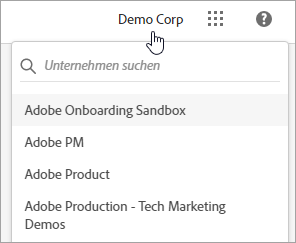
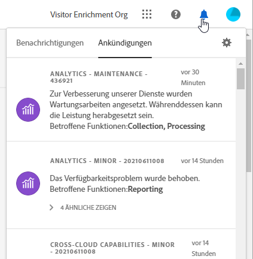
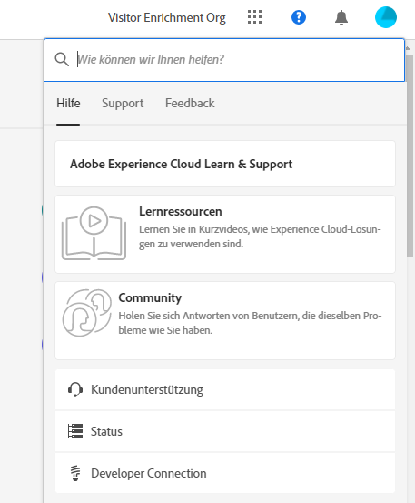

# Erste Schritte mit CX Enterprise {#get-started}

Melden Sie sich bei [Adobe CX Enterprise](https://experience.adobe.com) an, um Ihre Programme zu starten. Verwenden Sie dann den einheitlichen Header, um Ihr Profil zu verwalten, Benachrichtigungen zu prüfen und Hilfe zu finden - alles von einem Ort aus.

## Voraussetzungen {#before-you-begin}

Sie benötigen eine Adobe ID, die für die CX Enterprise-Produkte Ihres Unternehmens bereitgestellt wurde. Wenn Sie sich nicht anmelden können oder die erwarteten Programme nicht angezeigt werden, wenden Sie sich an Ihren [!UICONTROL CX Enterprise][Administrator](administration/admin-console.md).

## Bei CX Enterprise anmelden {#sign-in}

Melden Sie sich an und stellen Sie sicher, dass Sie sich in der richtigen [Organisation](administration/organizations.md) befinden.

1. Navigieren Sie zu [Adobe CX Enterprise](https://experience.adobe.com).
1. Geben Sie Ihre Adobe-E-Mail-Adresse ein und klicken Sie dann auf **[!UICONTROL Weiter]**.
1. Klicken Sie auf ein Konto.
1. Geben Sie Ihr Passwort ein.
1. Stellen Sie sicher, dass Sie sich in der richtigen Organisation befinden.

   

   **Organisation überprüfen**

   Die [Organisation](administration/organizations.md) wird in der Kopfzeile der Benutzeroberfläche angezeigt.

   Wenn Ihr Unternehmen Federated IDs verwendet, können Sie sich mit CX Enterprise beim Single Sign-on Ihres Unternehmens anmelden, ohne Ihre E-Mail-Adresse und Ihr Passwort eingeben zu müssen. Fügen Sie `#/sso:@domain` zur CX Enterprise-URL (`https://experience.adobe.com`) hinzu, um diese Aufgabe zu erfüllen.

   Setzen Sie beispielsweise für eine Organisation mit Federated IDs und der Domain `example.com` Ihren URL-Link auf `https://experience.adobe.com/#/sso:@example.com`. Sie können auch direkt zu einem bestimmten Programm gehen, indem Sie diese URL, an die der Programmpfad angehängt ist, als Lesezeichen speichern. (Beispiel für Adobe Analytics: `https://experience.adobe.com/#/sso:@example.com/analytics`.)

   **Hinweis:** Der Administrator Ihres Unternehmens kann den Zugriff auf Adobe-Produkte anhand von IP-Adressen einschränken. Wenn ja, erhalten Sie möglicherweise eine Fehlermeldung, nachdem Sie sich bei CX Enterprise angemeldet haben oder zu einem Unternehmen gewechselt haben, für das diese Option aktiviert ist. Weitere Informationen finden Sie unter [Produktzugriff nach IP-Adressen beschränken](https://helpx.adobe.com/enterprise/using/ip-based-access.html).

## Zugriff auf CX Enterprise-Programme {#applications}

Nach der Anmeldung bei CX Enterprise können Sie über den einheitlichen Header schnell auf alle Ihre Programme, Services und Organisationen zugreifen.

Rufen Sie die Programmauswahl auf (Menü), um auf die in Ihrem Unternehmen für Sie .

## Verwalten des Benutzerprofils {#profile}

Im Menü [!UICONTROL Profil] haben Sie folgende Möglichkeiten:

* Festlegen eines dunklen Designs (nicht alle Anwendungen unterstützen dieses Design)
* CX Enterprise verwalten [Voreinstellungen](features/account-preferences.md)
* Auswählen von oder Suchen nach [Organisationen](administration/organizations.md)
* Anzeigen [!UICONTROL Rechtliche Hinweise]
* Abmelden
* Einstellungen, Benachrichtigungen und Abonnements für das Konto konfigurieren

## Anzeigen von Benachrichtigungen und Ankündigungen im Produkt {#notifications}

Klicken Sie auf das Glockensymbol, um Benachrichtigungen und Ankündigungen anzuzeigen. Bei Ankündigungen kann es sich um relevante und umsetzbare Aktualisierungen handeln, einschließlich Produktversionen, Wartungshinweisen, freigegebenen Elementen und Genehmigungsanfragen.

Informationen zum Verwalten von Benachrichtigungen und Warnhinweisen finden Sie unter [Kontovoreinstellungen und Benachrichtigungen](features/account-preferences.md).

## Hilfe und Support {#help}

Greifen Sie mithilfe des **[!UICONTROL Hilfezentrums]** () in der Kopfzeile auf Lernmaterialien und Hilfe zu, einschließlich Hilfeinhalten (Dokumentation, Tutorials und Kurse) zu [Experience League](https://experienceleague.adobe.com/de#home) sowie zusätzlichen Ressourcen für einzelne Programme. Sie können auch ein unverbindliches Feedback senden und priorisierte Support-Tickets erstellen.

Das [!UICONTROL Hilfe]-Menü bietet Ihnen außerdem Zugriff auf:

* **[!UICONTROL Support]:** Erstellen Sie ein Support-Ticket oder kontaktieren Sie [!UICONTROL Support] über Twitter.
* **[!UICONTROL Feedback]:** Teilen Sie Feedback zu Ihrem CX Enterprise-Erlebnis. Ihr Feedback wird verwendet, um die Produkte und Services von Adobe zu verbessern.
* **[!UICONTROL Status]:** Navigieren Sie zu `https://status.adobe.com/experience_cloud` und überprüfen Sie den Betriebsstatus des Produkts und [!UICONTROL Abonnements verwalten].
* **[!UICONTROL Developer Connection]:** Navigation zum `adobe.io` und zur Entwicklerdokumentation.

## Weitere Hilfe zu diesem Thema {#more-help}

* [Benutzer- und Produktverwaltung in der Admin Console](administration/admin-console.md)
* [Erste Schritte mit dem People -Service](services/getting-started.md)
* [Kontovoreinstellungen und Benachrichtigungen](features/account-preferences.md)
