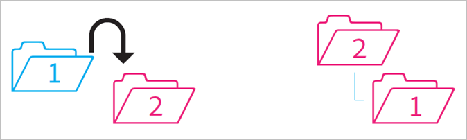
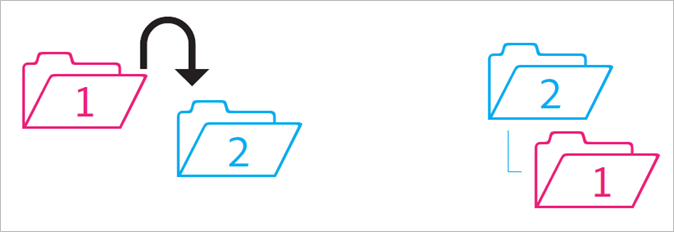
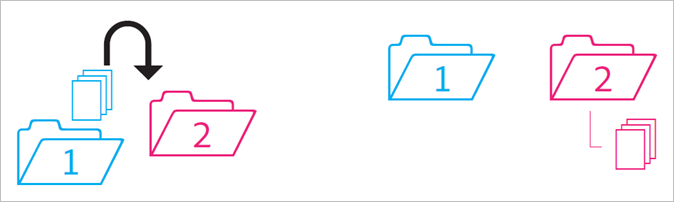
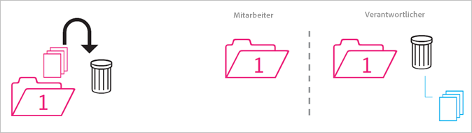
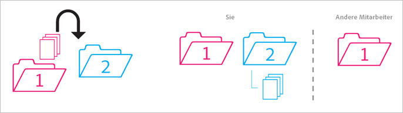
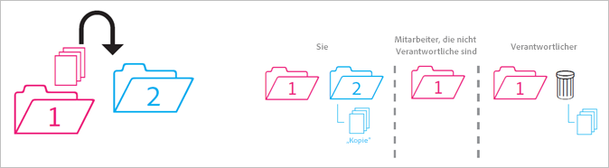
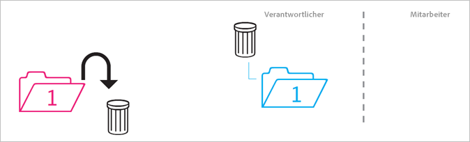
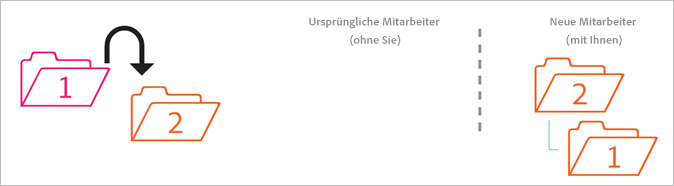
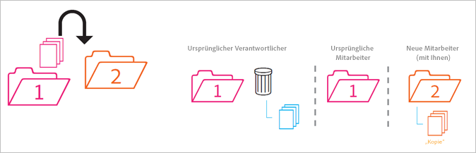
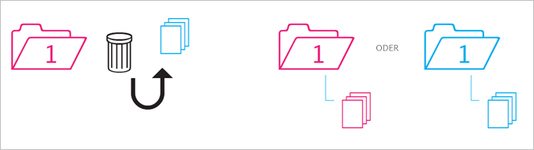

# Verhalten freigegebener Ordner

Richtlinien zum Verhalten freigegebener Ordner beim Verschieben, Löschen und Wiederherstellen.

>[!NOTE]
>
>Freigegebene CX Enterprise-Ordner und -Assets werden 1:1 auf dem Creative Cloud-Desktop gespiegelt. Wenn ein CX Enterprise-Benutzer einen Ordner ändert (löscht, fügt hinzu oder entfernt die Freigabe), wird die Aktion auf dem Creative Cloud-Desktop und im Web gespiegelt. Wenn die Freigabe eines Ordners aufgehoben wird, werden daher der Ordner und die Assets vom lokalen Computer gelöscht. Nachdem die Freigabe aufgehoben wurde, werden der Ordner und sein Inhalt in den Papierkorb auf Ihrem lokalen Computer verschoben, von wo Sie sie manuell auf Ihrem Computer wiederherstellen können.

## Nicht freigegebener Ordner in einen freigegebenen Ordner

Sie verschieben einen nicht freigegebenen Ordner in einen freigegebenen Ordner:

**Ergebnis**: Beide Ordner werden freigegeben.

## Freigegebener Ordner in einen nicht freigegebenen Ordner

Sie verschieben einen freigegebenen Ordner in einen nicht freigegebenen Ordner.

**Ergebnis**: Der nicht freigegebene Ordner bleibt nicht freigegeben. Der freigegebene Ordner bleibt freigegeben.

## Inhalt eines nicht freigegebenen Ordners in freigegebenen Ordner

Sie verschieben Content aus einem nicht freigegebenen Ordner in einen freigegebenen Ordner.

**Ergebnis:** Der Inhalt wird jetzt freigegeben, und alle Mitwirkenden können ihn sehen. Der Platz für die Datenspeicherung erhöht sich um die Inhaltsgröße.

## Archivierter und gelöschter freigegebener Inhalt

Sie archivieren oder löschen Inhalte, die sich in einem freigegebenen Ordner befinden.

**Ergebnis:** Der Inhalt wird für den Eigentümer des Ordners archiviert. Mitwirkende, die nicht Eigentümer des Content sind, können nicht mehr darauf zugreifen.

## Eigener freigegebener Inhalt in nicht freigegebenen Ordner

Sie verschieben Inhalte aus einem freigegebenen Ordner, dessen Eigentümer Sie sind, in einen nicht freigegebenen Ordner.

**Ergebnis:** Die Inhalte werden jetzt nicht mehr freigegeben. Die am freigegebenen Ordner Mitwirkenden haben auf den Inhalt keinen Zugriff mehr.

## Inhalt eines anderen Benutzers in nicht freigegebenen Ordner

Sie verschieben Inhalte aus freigegebenen Ordnern, die Eigentum einer anderen Person sind, in einen nicht freigegebenen Ordner.

**Ergebnis:** Der Inhalt wird im nicht freigegebenen Ordner angezeigt und aus dem freigegebenen Ordner entfernt. Die am freigegebenen Ordner Mitwirkenden haben auf den Inhalt keinen Zugriff mehr. Der Inhalt wird für den Eigentümer des freigegebenen Ordners archiviert.

Eigentümer und Editoren können Inhalte verschieben, die ihnen nicht gehören, aber Betrachter können dies nicht. Wenn Eigentümer bzw. Eigentümerinnen und Editoren Inhalte verschieben, stehen diese keinem Benutzenden in einem freigegebenen Ordner zur Verfügung.

## Archivierter oder gelöschter eigener Ordner

Sie archivieren (über das Web) oder löschen (über den Desktop) einen freigegebenen Ordner, dessen Eigentümer bzw. Eigentümerin Sie sind.

**Ergebnis:** Der Ordner wird nicht freigegeben; anschließend wird er archiviert. Die Mitwirkenden haben keinen Zugriff mehr auf den Ordner.

## Freigegebener Ordner in einen anderen freigegebenen Ordner

Sie verschieben einen freigegebenen Ordner, dessen Eigentümer Sie sind, in einen anderen freigegebenen Ordner, egal ob Sie dessen Eigentümer sind oder nicht.

**Ergebnis:** Wenn der Ordner in Ordner 2 verschoben wird, wird er für die neuen Mitwirkenden freigegeben.

## Freigegebener Inhalt in einen anderen freigegebenen Ordner

Sie verschieben Inhalte aus einem freigegebenen Ordner in einen anderen freigegebenen Ordner.

**Ergebnis:** Der Inhalt wird in Ordner 2 angezeigt und jetzt für neue Mitwirkende freigegeben. Der Content wird aus dem Ordner 1 entfernt, und der Eigentümer bzw. die Eigentümerin sieht ihn als archiviert, während die anderen Mitwirkenden keinen Zugriff mehr darauf haben.

## Aus Archiv wiederhergestellter Inhalt

Sie stellen Content aus einem Archiv wieder her, das zu einem freigegebenen Ordner gehörte. Sie waren zum Zeitpunkt der Archivierung Eigentümer des Inhalts.

**Ergebnis:** Der Inhalt wird im freigegebenen Ordner wiederhergestellt und alle Mitwirkenden können erneut darauf zugreifen. Wenn der freigegebene Ordner nicht mehr vorhanden ist, wird der Inhalt in eine nicht freigegebene Kopie des/der ursprünglichen übergeordneten Ordner(s) eingefügt.
